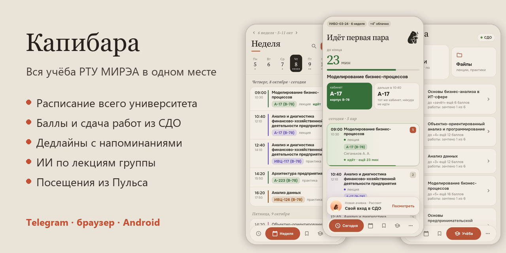
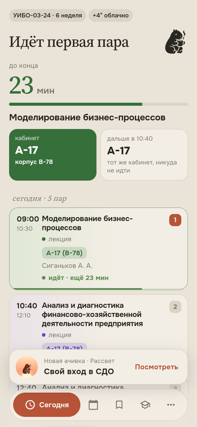
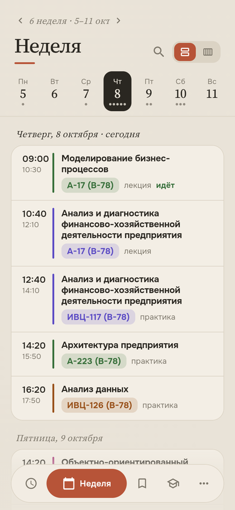
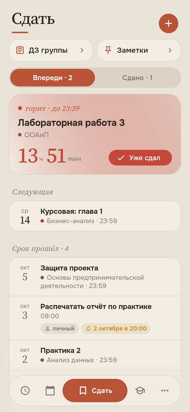
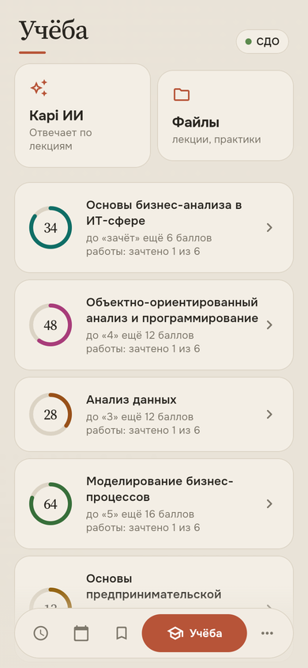
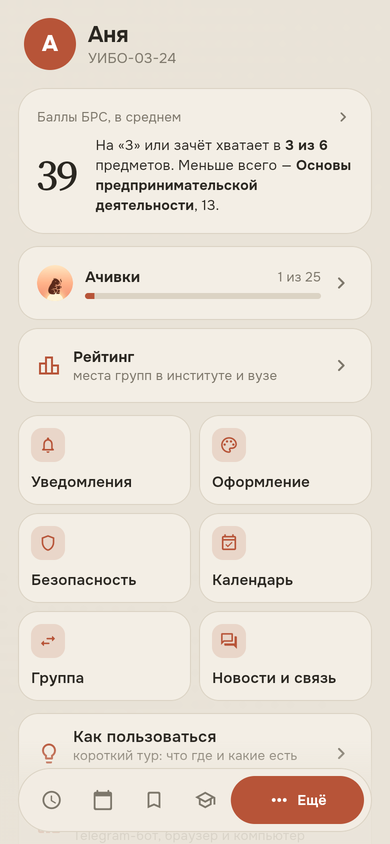
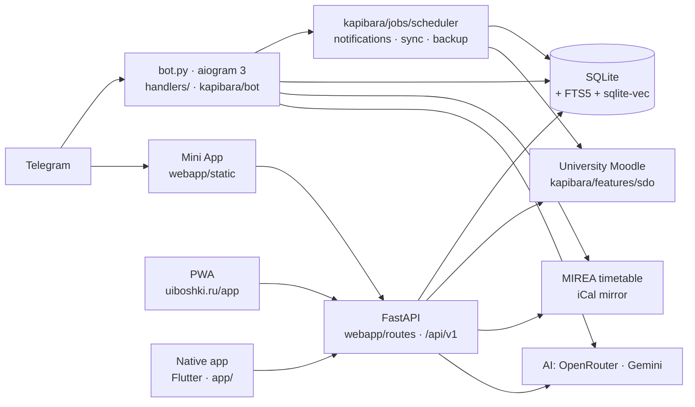

# Kapibara — study app for RTU MIREA students

English · [Русский](README.md)



[](https://github.com/mekit54567/uiboshki-bot/actions/workflows/ci.yml)


Kapibara is an unofficial study app for students of RTU MIREA, a large
technical university in Moscow. It puts the timetable, grades and assignment
submission from the university's Moodle, deadline reminders, course files and
an AI assistant grounded in the group's own lecture slides into one place. It
started in April 2026 as a Telegram bot for one study group and is now a
Telegram Mini App, an installable web app and native iOS and Android apps on a
single backend. It is made by a student and is not affiliated with the
university.

## Try it in one minute

- **Live demo, no sign-in:** [uiboshki.ru](https://www.uiboshki.ru) runs the
  real app in a phone frame on made-up data.
- **App Store:** [Kapibara](https://apps.apple.com/app/id6828117584) (the store
  listing is «Капибара — учёба МИРЭА»; available in New Zealand too).
- **Android:** [RuStore](https://www.rustore.ru/catalog/app/ru.uiboshki.app),
  the Russian Android app store.
- **Web app:** [uiboshki.ru/app](https://www.uiboshki.ru/app), installable as
  a PWA. **Telegram:** [@UiboshkiBot](https://t.me/UiboshkiBot).
- **Demo account:** on the sign-in screen tap «Вход по коду доступа» (sign in
  with an access code). The code is available from the author on request; it
  opens a demo account with made-up grades, deadlines and lectures, and a real
  AI assistant answering from them.

The interface is in Russian.

<table>
<tr>
<td></td>
<td></td>
<td></td>
<td></td>
<td></td>
</tr>
<tr>
<td align="center">Today</td><td align="center">Week</td><td align="center">To submit</td>
<td align="center">Grades</td><td align="center">More</td>
</tr>
</table>

<sub>The Flutter app, captured by the automated UI check on demo data: no real
students' grades or files.</sub>

## At a glance

| | |
|---|---|
| Timeline | April 2026 → now; one person on the product, built with AI coding agents |
| Users | about 30 students ahead of the public launch |
| Clients | Telegram bot + Mini App, PWA with web push, iOS and Android apps (Flutter), all on one versioned API |
| Code | ~41k lines of Python, ~17k lines of web frontend (plain JS/CSS, no build step), ~29k lines of Dart |
| Tests | 1,250+ backend tests, 380+ app tests, GitHub Actions on every pull request |
| History | 1,400+ commits, 370+ pull requests, 500+ versions in the [changelog](CHANGELOG.md) (in Russian) |
| Decisions | 7 architecture decision records in [`docs/adr/`](docs/adr/) (in Russian) |

## Engineering highlights

Each item links to where it lives in the repository. Most code comments and
docs are in Russian; the code itself reads fine without them.

**One API, four clients.** The bot's Mini App, the PWA and the Flutter apps
all use the same REST API under `/api/v1`. The list of endpoints is pinned in
[`tests/api_contract.json`](tests/api_contract.json): removing a path fails CI,
so a server update cannot silently break an app that is already installed on
someone's phone. The snapshot is refreshed with
[`tools/api_snapshot.py`](tools/api_snapshot.py).

**Moodle without an official API.** The university's Moodle has no public API
for students, so the app integrates with it using each student's own login:
deadlines through the calendar's internal AJAX calls, grades by reading the
grade report, and assignment submission through the same request chain a
browser uses (draft area → upload → save → submit for grading). Student
sessions are stored encrypted (Fernet, key kept apart from the database, key
rotation on start). See [`kapibara/features/sdo/`](kapibara/features/sdo/) and
[`kapibara/core/crypto.py`](kapibara/core/crypto.py).

**AI answers that cite the lecture slide.** Lectures are split by slide or
page and indexed in SQLite twice: FTS5/BM25 for words and `sqlite-vec` for
meaning. The two result lists are merged with Reciprocal Rank Fusion, MMR
removes near-duplicates, and the model gets numbered chunks it must cite, so
each answer ends with «Lecture 5 · slide 12» and the page is rendered on the
server. See
[`semantic_index.py`](kapibara/features/ai/semantic_index.py) and
[`semantic_search.py`](kapibara/features/ai/semantic_search.py).

**The whole university's timetable without a search API.** The timetable
mirror serves calendars by numeric id but has no search. The app builds its
own directory: it walks the ids and reads only the first kilobyte of each
calendar with an HTTP `Range` request, where the name of the group, teacher or
room sits. Thousands of entries, refreshed monthly, searched with plain SQL.
See [`kapibara/features/schedule/index.py`](kapibara/features/schedule/index.py).

**Safe deploys with automatic rollback.** The server only takes a commit that
passed CI. Before starting a new build it copies the database, then waits for
`/ready` (database, schema and routers up); if that does not come within five
minutes, it rolls back to the last good build and notifies the admin. See
[ADR 0005](docs/adr/0005-safe-deploy.md) (in Russian),
[`deploy/timeweb/update.sh`](deploy/timeweb/update.sh) and
[`.github/workflows/deploy.yml`](.github/workflows/deploy.yml).

**Push notifications the push service cannot read.** For the native apps the
phone generates an AES-256 key when notifications are turned on; the server
encrypts the title and text, and FCM, RuStore and APNs only carry ciphertext.
Web push follows RFC 8291 (aes128gcm + VAPID) implemented on `cryptography`
without a web-push library. See
[`app_push.py`](kapibara/features/notifications/app_push.py),
[`webpush.py`](kapibara/features/notifications/webpush.py) and
[`docs/app-push.md`](docs/app-push.md) (in Russian).

**Security basics done properly.** Mini App requests are authenticated by
checking Telegram's `initData` HMAC signature ([`webapp/auth.py`](webapp/auth.py)),
file links are signed and expire after 10 minutes, rate limits key on the real
client IP (the right-most public address in `X-Forwarded-For`, since the
left-most one is set by the client) — see
[`kapibara/core/ratelimit.py`](kapibara/core/ratelimit.py).

**iOS builds without a Mac.** The iOS app is built, signed and uploaded to
TestFlight from GitHub Actions. See
[`.github/workflows/app-build.yml`](.github/workflows/app-build.yml) and
[`docs/store/ios-signing.md`](docs/store/ios-signing.md) (in Russian).

**A quality ratchet instead of a big rewrite.** CI counts broad `except`
clauses, silent `pass`, import cycles and lint/type errors and compares them
with ceilings in [`tools/ratchet.json`](tools/ratchet.json). A number may only
go down: more fails CI, and fewer fails too until the ceiling is lowered, so an
improvement cannot be quietly undone. See
[`tools/ratchet.py`](tools/ratchet.py) and
[ADR 0006](docs/adr/0006-ratchet.md) (in Russian).

## Architecture



The bot and the API run in one process with one SQLite database, in Docker
behind Caddy (HTTPS) on a server in Moscow.

| Layer | Used |
|---|---|
| Bot | aiogram 3, APScheduler, inline mode, Mini App |
| Backend | FastAPI + uvicorn in the bot process, aiosqlite |
| AI | OpenRouter and Gemini with fallback models |
| Search | SQLite FTS5 (BM25), sqlite-vec, local or Gemini embeddings, RRF + MMR |
| Data | httpx, BeautifulSoup, icalendar, pypdf / python-pptx / python-docx, pypdfium2 |
| Outside Telegram | PWA (service worker, web push), OAuth with VK ID and Yandex ID, Sign in with Apple |
| App | Flutter (Android and iOS), design tokens shared with the web |
| Quality | pytest, ruff, mypy, flutter test, automated UI check in Chromium, GitHub Actions |
| Server | Docker Compose, Caddy; deploy after green CI with `/ready` and rollback |

## How this project is built

I am the only person on the product. I decide what to build and in what
order, choose the architecture and design, test every version by hand, review
and merge pull requests, run the server and handle store releases, payments
and the paperwork required by Russian personal data law. I write and fix code
myself too, but most of it is written by an AI coding agent (Claude Code) from
my task descriptions, and the commit history shows this openly.

Quality does not rest on trusting whoever wrote a line. It rests on rules that
every change has to pass:

- every change is a separate branch and pull request; CI must be green before
  I merge;
- every bug gets a test that catches it;
- architecture decisions are written down in [`docs/adr/`](docs/adr/);
- the quality ratchet ([`tools/ratchet.py`](tools/ratchet.py)) only lets the
  number of known problems go down;
- the API contract is pinned in [`tests/api_contract.json`](tests/api_contract.json);
- the server deploys only green builds and rolls back on its own
  ([ADR 0005](docs/adr/0005-safe-deploy.md));
- each pull request adds a short note to `changelog.d/next/`, and a release
  pull request about every ten PRs turns them into a version in the
  [changelog](CHANGELOG.md).

[`CLAUDE.md`](CLAUDE.md) is the working brief for the AI agent: project rules,
how the system is put together and the agreements made along the way. It is
kept in the repository on purpose, as it is how the agent is managed.
[`PLAN.md`](PLAN.md) is the roadmap. All three are in Russian.

## Repository map

| Path | What is there |
|---|---|
| `kapibara/` | the server: `core/`, `features/` (schedule, Moodle, AI, notifications…), `jobs/`, `bot/` |
| `app/` | the Flutter app for iOS and Android |
| `webapp/` | FastAPI routes and `static/` — the Telegram Mini App, the PWA and the website |
| `database/`, `handlers/` | the database layer and Telegram handlers from the earlier layout; code is moving into `kapibara/` step by step ([ADR 0001](docs/adr/0001-package-layout.md), [ADR 0003](docs/adr/0003-safe-moves.md)) |
| `tests/` | backend and frontend tests |
| `tools/` | release notes, ratchet, API snapshot, build helpers |
| `deploy/` | server setup and the update script with rollback |
| `docs/` | ADRs, store materials, guides (in Russian) |
| `channel/` | posts for the project's Telegram channel |

## Run and test

```bash
pip install -r requirements-dev.txt
BOT_TOKEN=... python bot.py   # the bot; with WEBAPP_URL set, also the API and Mini App
pytest                        # backend tests, no network access
ruff check .                  # linter
cd app && flutter test        # app tests
```

The full list of environment variables is in the
[Russian README](README.md#запуск).

## Privacy

Kapibara is not an official university service. Each student connects Moodle
with their own login and sees only their own grades and submissions. Consent
to data processing and account deletion follow Russian personal
data law (152-FZ); the server is in Russia.

## Author

Nikita Kurashkin, third-year Business Informatics student at RTU MIREA.
Telegram [@Party_lo](https://t.me/Party_lo) · GitHub [@mekit54567](https://github.com/mekit54567).
Open to a remote internship or part-time role alongside my studies.

Found a security problem? See [SECURITY.md](SECURITY.md).

## License

The source code is published so that it can be read and reviewed. It is not
open source: all rights are reserved by the author, and copying or reusing the
code, name or design requires permission.
