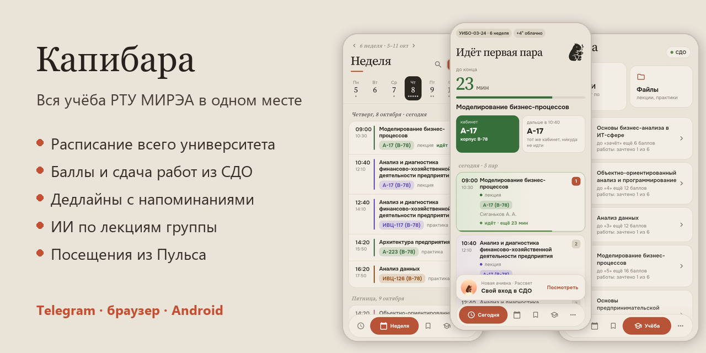
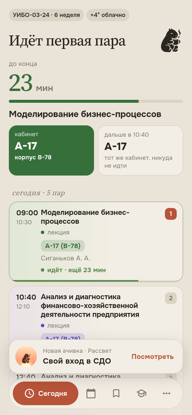
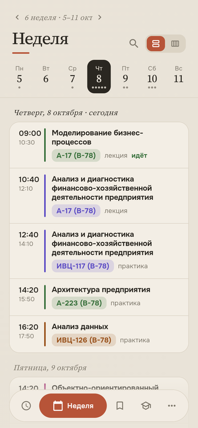
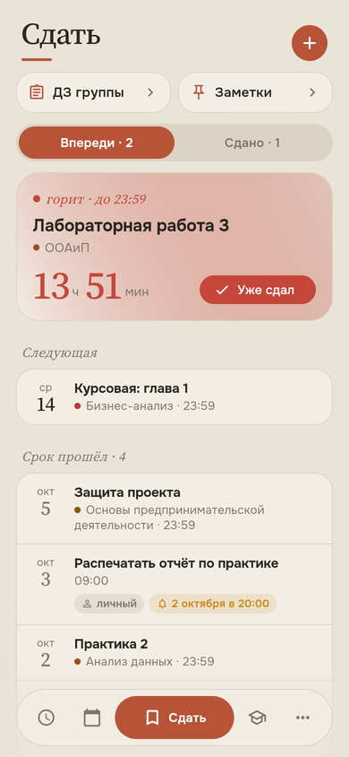
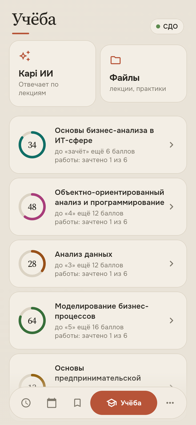
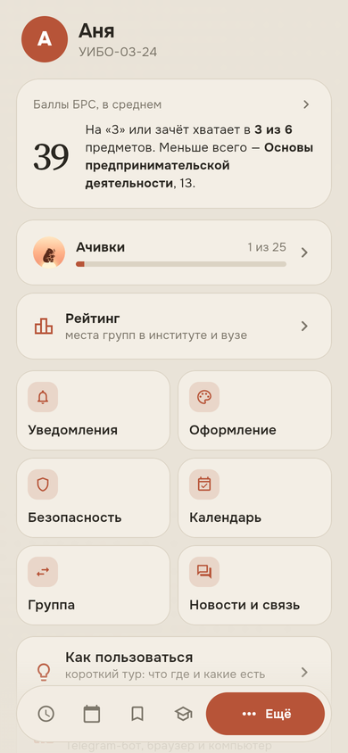
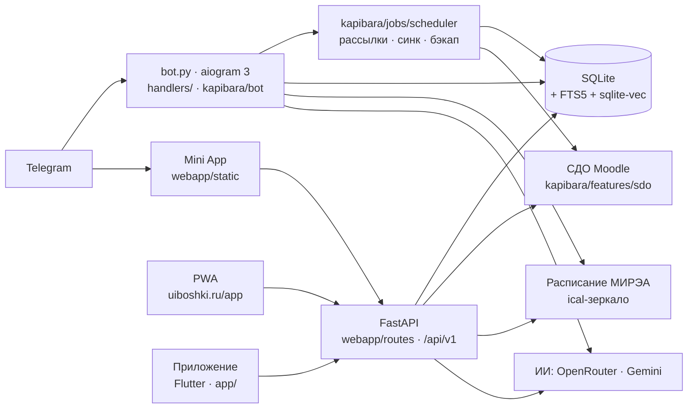

# Капибара — учёба МИРЭА

Русский · [English](README.en.md)



[](https://github.com/mekit54567/uiboshki-bot/actions/workflows/ci.yml)


**Вся учёба — в Telegram, в браузере и в своём приложении.** Расписание всего
университета, баллы и сдача работ из СДО, дедлайны с напоминаниями, файлы
курсов с поиском внутри лекций и ИИ, который отвечает по лекциям группы и
показывает слайд, откуда взял ответ. Начинался как бот
[@UiboshkiBot](https://t.me/UiboshkiBot) группы УИБО-03-24, теперь — для любой
группы РТУ МИРЭА.

> Неофициальное приложение для студентов РТУ МИРЭА. Его сделали студенты, а не университет.

**[Сайт с живым демо](https://www.uiboshki.ru)** ·
**[Бот в Telegram](https://t.me/UiboshkiBot)** ·
**[Без Telegram — uiboshki.ru/app](https://www.uiboshki.ru/app)** ·
**[App Store](https://apps.apple.com/app/id6828117584)** ·
**[RuStore](https://www.rustore.ru/catalog/app/ru.uiboshki.app)** ·
**[Новости — @kapibara_mirea](https://t.me/kapibara_mirea)** ·
**[Канал о разработке](https://t.me/uiboshki_dev)**

## Попробовать за минуту

- **[Живое демо на сайте](https://www.uiboshki.ru)** — настоящее приложение в
  рамке телефона на выдуманных данных, без входа;
- **[App Store](https://apps.apple.com/app/id6828117584)**, **[RuStore](https://www.rustore.ru/catalog/app/ru.uiboshki.app)**
  или **[uiboshki.ru/app](https://www.uiboshki.ru/app)** в браузере;
- **демо-аккаунт**: на экране входа — «Вход по коду доступа», код — по запросу
  у автора. Внутри выдуманные баллы, сроки и лекции и настоящий ИИ, который
  отвечает по ним.

<table>
<tr>
<td></td>
<td></td>
<td></td>
<td></td>
<td></td>
</tr>
<tr>
<td align="center">Сегодня</td><td align="center">Неделя</td><td align="center">Сдать</td>
<td align="center">Учёба</td><td align="center">Ещё</td>
</tr>
</table>

<sub>Приложение «Капибара» (Flutter), снято роботом-проверкой на демо-данных:
ничьих настоящих баллов и файлов.</sub>

## Где пользоваться

| | Как открыть | Что особенного |
|---|---|---|
| **Telegram** | [@UiboshkiBot](https://t.me/UiboshkiBot) → «Открыть приложение» | бот сам пишет про пары и сроки, inline-режим в любом чате |
| **Телефон без Telegram (PWA)** | [uiboshki.ru/app](https://www.uiboshki.ru/app) → iPhone: «Поделиться → На экран „Домой“», Android: «Установить приложение» | вход через Telegram, VK ID или Яндекс ID, уведомления пушем, расписание без сети |
| **Компьютер** | тот же адрес в Chrome, Edge или Яндекс Браузере → «Установить» | отдельное окно, как обычная программа |
| **Android и iPhone** | своё приложение «Капибара» на Flutter (`app/`): iPhone — [в App Store](https://apps.apple.com/app/id6828117584), Android — [в RuStore](https://www.rustore.ru/catalog/app/ru.uiboshki.app) | вход в СДО обычной страницей МИРЭА, пуши, ачивки |

Данные везде одни: что отметил в Telegram — видно в PWA и в приложении.

## Проект в цифрах

| | |
|---|---|
| Срок | апрель 2026 → сейчас; продукт веду один, код пишу вместе с ИИ-агентом |
| Пользователи | около 30 студентов до публичного запуска |
| Код | ~40 тыс. строк Python, ~17 тыс. — фронтенд Mini App и PWA (без фреймворков и сборки), ~29 тыс. — приложение на Flutter |
| Платформы | Telegram (бот + Mini App), PWA с веб-пушами, Android и iOS (Flutter) — одно API `/api/v1` |
| Тесты | 1250+ автотестов бэкенда и фронта, 380+ тестов приложения, CI (GitHub Actions) на каждый pull request |
| История | 1400+ коммитов, 370+ pull request'ов, 500+ версий в [CHANGELOG](CHANGELOG.md) |

## Что умеет

**📅 Расписание**
- главная: следующая пара с обратным отсчётом, пары на сегодня, погода;
  плашка «сегодня пары на МП-1, а не на В-78», если корпус не свой;
- неделя по дням: у каждой пары — баллы по предмету из СДО, нажатие ведёт в
  её текущий контроль;
- поиск расписания любого преподавателя, группы или аудитории МИРЭА —
  работает даже с VPN; подписка на него в календаре телефона;
- сайт МИРЭА лежит — бот показывает сохранённую копию с пометкой времени.

**🎓 СДО (Moodle) — своим входом**
- баллы БРС по каждому предмету: категории, пороги, график роста;
- цель по предмету: выбрал зачёт или «3/4/5» — сколько не хватает, откуда
  взять и хватает ли зачтённых работ (правило 75 %);
- посещения лекций — восстановлены из баллов за посещаемость, а с
  подключённым Пульсом (пока в пробном режиме) — его отметки;
- сдача работ прямо из Telegram: бот заранее показывает, какие файлы примет
  задание; сдал — дедлайн отмечается сам;
- бот пишет сам: изменились баллы, появилось новое задание, перенесли срок.

**📂 Файлы и лекции**
- сотни файлов курсов, разложенные по предметам и типам (лекции, практики,
  КР, методички), понятные названия вместо «ЛК3_бизнес_финал.pdf»;
- **поиск внутри лекций**: «дисконтирование» → «Лекция 5 · слайд 12» и
  отрывок, нажал — открылась страница;
- конспект любой лекции одной кнопкой — один на всю группу;
- «скинь практику 3 по ООП» прямо в чате.

**✨ ИИ по лекциям группы**
- чат и решалка отвечают по материалам группы, а не «вообще»: под ответом —
  ссылки на слайды, откуда взята информация;
- фото задачи → решение с объяснением; математика читаемая (x², √, ≤);
- знает расписание и дедлайны: на «что сдавать на неделе?» отвечает по делу.

**🔔 Уведомления — под себя**
- утро: пары, погода, другой корпус; выбор дней, «только если есть пары»;
- перед парой — три сценария (первая пара, после короткой перемены, после
  большого перерыва); дедлайны; воскресный обзор недели с ростом баллов.

**💬 В любом чате** — inline-режим: `@UiboshkiBot` → картинка с расписанием.

**🌐 Сайт** — живое приложение на выдуманных данных, поиск расписания МИРЭА
без входа, светлая и тёмная тема.

**📱 Без Telegram** — [uiboshki.ru/app](https://www.uiboshki.ru/app): то же
приложение ставится на экран телефона или компьютера (PWA), вход через бота,
VK ID или Яндекс ID, уведомления — веб-пушем, последнее открытое — без сети. Своё
приложение «Капибара» — в [App Store](https://apps.apple.com/app/id6828117584)
и [RuStore](https://www.rustore.ru/catalog/app/ru.uiboshki.app), на том же API.

**👑 Для старосты** — рассылки, статистика (`/stats`), состояние бота
(`/status`), тревога при всплеске ошибок, посты канала, ночной бэкап базы.

## Инженерные задачи, которые пришлось решить

**Расписание, когда API недоступен.** Официальный поиск МИРЭА не отвечал
серверу за рубежом (пока бот жил там), а у зеркала поиска нет вовсе. Бот сам собирает
справочник: перебирает id календарей и с каждого читает только первый
килобайт (HTTP `Range`) — там название группы или преподавателя. Тысячи
групп, преподавателей и аудиторий, обновление раз в месяц, поиск — обычный
SQL по своей базе.

**Moodle без API.** Дедлайны — через внутренний AJAX календаря, баллы —
разбор журнала оценок, сдача работ — та же цепочка запросов, что у браузера
(черновая область → загрузка → сохранение → «отправить на проверку»). Типы
файлов задания берутся из настроек файлового менеджера, а не из первого
попавшегося списка: у редактора текста на той же странице свой список
(картинки), и на нём бот однажды споткнулся.

**ИИ, который отвечает по лекциям (RAG).** Лекции режутся по слайдам и
страницам, индекс — SQLite: FTS5/BM25 по словам и векторы Gemini в
`sqlite-vec` по смыслу. Два списка сливаются через Reciprocal Rank Fusion,
MMR убирает повторы, ИИ получает куски с номерами и ссылается на них — под
ответом «Лекция 5 · слайд 12», а страница PDF рисуется на сервере.

**Посещаемость по СДО и Пульсу.** Посещения восстанавливаются из
баллов СДО: баллы за посещаемость делятся поровну на лекции семестра, бот
решает, сколько посещено и сколько отработок, а по ежедневной истории баллов
видно, какие именно лекции засчитаны. Если подключён Пульс университета
(пока в пробном режиме), отметки по лекциям берутся оттуда и хранятся у себя:
Пульс отвалился — прошлые лекции остаются такими, как он сказал.

**Безопасность.** Вход в Mini App — по подписи Telegram `initData` (HMAC),
входы студентов в СДО зашифрованы (Fernet, ключ отдельно от базы), ссылки на
файлы подписаны и живут 10 минут, лимиты частоты по настоящему IP (самый
правый публичный адрес `X-Forwarded-For` — первый подставляет посетитель),
ограничение размера запросов, заголовки безопасности.

**Надёжность на бесплатных лимитах.** Кэш и «одна загрузка на всех» для
календарей, запасная копия расписания, запасные модели ИИ при исчерпанном
лимите, дневной лимит вопросов на человека (выключатель), тревога старосте
при всплеске ошибок, ночной бэкап базы с восстановлением одной командой.

**Выкладка без страха.** Сервер берёт свежий `main` только после зелёного
CI. Перед запуском новой версии бот сохраняет копию базы, после запуска
сервер спрашивает `/ready` (база, схема и роутеры поднялись), и если ответа
нет, сам возвращает прошлую сборку кода и пишет старосте.

## Как устроено



Бот и Mini App — один процесс и одна база: Docker-контейнер и Caddy (HTTPS) на
своём сервере Timeweb Cloud в Москве. Фронтенд — обычные скрипты без сборки; авторизация — по `initData` Telegram, вне Telegram —
токен сессии устройства (вход через бота, VK ID или Яндекс ID). PWA и своё
приложение ходят в версионированное API `/api/v1` (снимок контракта в тестах).

| Слой | Что используется |
|---|---|
| Бот | aiogram 3, APScheduler, inline-режим, Mini App кнопкой меню |
| Бэкенд | FastAPI + uvicorn в процессе бота, aiosqlite |
| ИИ | OpenRouter и Gemini (запасные модели при лимите), DeepSeek необязательно |
| Поиск | SQLite FTS5 (BM25), sqlite-vec, эмбеддинги — локальная модель или Gemini, RRF + MMR |
| Данные | httpx, BeautifulSoup (Moodle), icalendar, pypdf / python-pptx / python-docx, pypdfium2 |
| Картинки | Pillow — карточки расписания, статистика, обложки постов |
| Вне Telegram | PWA (service worker, веб-пуши RFC 8291 + VAPID без внешних библиотек), OAuth VK ID и Яндекс ID |
| Приложение | Flutter (Android и iOS), общие дизайн-токены с вебом, сборки APK/IPA в GitHub Actions |
| Качество | pytest (1250+), ruff, flutter test, робот-проверка приложения в Chromium, GitHub Actions |
| Сервер | Timeweb Cloud, Docker Compose, Caddy; выкладка после зелёного CI, `/ready` и автооткат |

Подробно для разработки — [CLAUDE.md](CLAUDE.md), история версий —
[CHANGELOG.md](CHANGELOG.md), план — [PLAN.md](PLAN.md).

## Как ведётся разработка

Продукт веду я один: решаю, что и в каком порядке делать, выбираю архитектуру
и дизайн, проверяю каждую версию руками, принимаю pull request'ы, настраиваю
сервер, выпускаю приложение в сторы, подключаю оплату и веду документы по
закону о персональных данных. Код правлю и пишу и сам, но большую часть по
моим задачам пишет ИИ-агент (Claude Code) — это честно видно в истории
коммитов. [CLAUDE.md](CLAUDE.md) — рабочая памятка для агента: правила,
устройство проекта и договорённости. Решения об устройстве кода — в
[docs/adr/](docs/adr/).

Качество держат правила, которые проходит каждое изменение:

- каждое изменение — отдельная ветка и pull request, CI зелёный до мержа;
- на каждый найденный баг — тест, который его ловит;
- храповик ([tools/ratchet.py](tools/ratchet.py)): число известных проблем в коде
  (широкие `except`, клубки импортов, ошибки линтера и типов) может только
  уменьшаться;
- список адресов API зафиксирован в [tests/api_contract.json](tests/api_contract.json):
  обновление сервера не сломает уже установленные приложения;
- PR кладёт короткую заметку в `changelog.d/next/`, а раз в ~10 PR релиз
  собирает их в версию [CHANGELOG](CHANGELOG.md) (`эпоха.фича.фикс`) с кодовым
  именем;
- сервер сам выкладывает свежий `main` после зелёного CI;
- большие выпуски проходят ревью кода, найденное чинится тем же PR;
- о том, как и почему делается бот, — [канал @uiboshki_dev](https://t.me/uiboshki_dev).

## Запуск

```bash
pip install -r requirements.txt
python bot.py          # бот; с WEBAPP_URL — и Mini App в том же процессе (порт PORT, по умолчанию 8080)
```

Главные переменные окружения (основные — в `kapibara/core/config.py`, остальные — в модулях,
которые их читают; шаблон для сервера — `deploy/timeweb/env.example`):

| Переменная | Зачем |
|---|---|
| `BOT_TOKEN` | токен бота (обязателен) |
| `STAROSTA_ID` | Telegram ID старосты, можно несколько через запятую |
| `WEBAPP_URL` | адрес Mini App (кнопки «Открыть приложение», сайт) |
| `OPENROUTER_API_KEY`, `GEMINI_API_KEY`, `DEEPSEEK_API_KEY` | ИИ; DeepSeek необязателен |
| `EMBED_PROVIDER` | чем считать векторы для поиска по смыслу: локальная модель или Gemini |
| `GEMINI_FALLBACK_MODELS`, `AI_DAILY_LIMIT` | запасные модели при лимите; вопросов к ИИ в сутки на человека (0 — без лимита) |
| `SDO_SESSION_COOKIE` | вход старосты в СДО (дедлайны и файлы курсов) |
| `SDO_CRYPT_PASSPHRASE` | секретная фраза — ключ шифрования входов студентов |
| `ICAL_URL`, `GROUP_NAME`, `BOT_USERNAME`, `GROUP_PROGRAM` | своя группа (по умолчанию — УИБО-03-24) |
| `CHANNEL_URL`, `CONTACT_URL` | ссылки плиток «Канал бота» и «Написать нам» в Mini App |
| `DATABASE_PATH` | где лежит SQLite |

## Тесты

```bash
pip install -r requirements-dev.txt
pytest          # 1250+ тестов, без сети
ruff check .    # линтер
```

Тесты реальные, не заглушки: настоящая SQLite (временный файл на каждый
тест), настоящий роутинг aiogram через `Dispatcher.feed_update` (так однажды
поймали баг с порядком регистрации, который прямые вызовы хендлеров не
видели), настоящая HMAC-проверка подписи Telegram, фронт — через
`node --check` и отрисовку в Chromium. В сеть наружу (Telegram, Gemini, СДО,
МИРЭА) тесты не ходят: такие вызовы подменяются точечно.

Тестами **не** покрыто: живые походы в Gemini и СДО (проверяются вручную на
живом боте) и сами таймеры APScheduler (тестируются функции, которые они
вызывают).

## Мониторинг

`GET /health` — жив ли процесс (для аптайм-чекера), `GET /ready` — поднялись ли
база, схема и роутеры (его спрашивает выкладка); `/api/meta` → `build` — какая
сборка сейчас на сервере; `/status` у старосты — синк СДО,
кука, бэкап, индекс поиска, ИИ и ошибки за сутки; при всплеске ошибок бот
пишет старосте сам.

## Автор

Никита Курашкин — студент 3 курса РТУ МИРЭА, староста УИБО-03-24 ·
Telegram [@Party_lo](https://t.me/Party_lo). Нашли уязвимость —
[SECURITY.md](SECURITY.md).

## Лицензия

Код открыт для чтения и проверки, но это не открытая лицензия: все права у
автора. Копировать и использовать код, название и дизайн — только с
разрешения.
